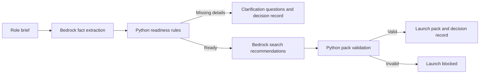

# AWS Bedrock AI | Role Intake and Search Launch

A small business process automation built with Python, Streamlit, and Amazon Bedrock. A hiring manager enters a rough role brief; the app extracts facts, checks whether the intake is complete, and either launches an internal search kickoff or requests missing information.

This is an independent portfolio project using fictional hiring data. “Launched” means a search kickoff record and materials were created locally. It does not mean candidates were contacted or a hiring decision was made.

## What the app does

1. Uses Amazon Nova 2 Lite on Bedrock to extract structured role facts.
2. Applies explicit Python rules to decide whether the intake is ready.
3. For complete intakes, creates a factual role specification, AI-assisted search strategy, and interview scorecard.
4. Validates the pack’s sections and scorecard weights before saving.
5. For incomplete intakes, creates clarification questions instead of a launch pack.
6. Saves each decision and its supporting output in the local `runs/` folder.

## Workflow



The role specification is assembled from extracted fields in Python. Bedrock generates the proposed search strategy and interview questions. The app does not automate candidate evaluation or hiring decisions.

## Technology

| Component | Purpose |
| --- | --- |
| Streamlit | Local web interface |
| Amazon Bedrock, Nova 2 Lite | Fact extraction and search recommendations |
| Boto3 | Python connection to AWS |
| Python business rules | Readiness checks, questions, and pack validation |
| Local JSON and Markdown files | Decision log and launch materials |

The app calls Bedrock from `ap-southeast-2` (Sydney) using Nova 2 Lite’s global inference ID. Global inference can route processing to other supported AWS regions; use fictional data for this demo. See the [Nova 2 Lite model card](https://docs.aws.amazon.com/bedrock/latest/userguide/model-card-amazon-nova-2-lite.html).

## Run locally

Prerequisites: Python 3.13, AWS CLI, an AWS profile with Bedrock model invocation permission, and access to Nova 2 Lite.

```bash
python3 -m venv .venv
source .venv/bin/activate
python -m pip install -r requirements.txt
aws login --profile bedrock-demo --region ap-southeast-2
AWS_PROFILE=bedrock-demo python -m streamlit run app.py
```

Replace `bedrock-demo` with the name of your own AWS profile. Do not put AWS keys in the source code.

## Demo: complete brief

> Our SaaS company needs a Head of Customer Success based in Sydney. They will lead a 12-person team, improve enterprise renewals, and report to the COO. We require experience scaling B2B SaaS customer success teams. The approved compensation range is AUD 180,000–220,000. The role is hybrid, with three days in the office. We would like the person to start within three months.

Expected status: **Launched internally**. The run folder contains `decision.json` and `launch-pack.md`.

## Demo: incomplete brief

> Our SaaS company needs a Head of Customer Success to improve enterprise renewals. This person will report to the COO and must have experience scaling B2B SaaS customer success teams. We have not decided the work location, and compensation has not been approved yet.

Expected status: **Needs information**. The run folder contains `decision.json` with clarification questions and no launch pack.

## Cost and data

A complete intake makes two Bedrock requests; an incomplete intake makes one. Bedrock inference is billed by usage; see [AWS pricing](https://aws.amazon.com/bedrock/pricing/). Saved runs remain on the local machine and are excluded from Git. Use fictional briefs when demonstrating the app.

## Current limitations

- This is a local demo, not an ATS or candidate outreach integration.
- Pack validation checks required sections and scorecard weights; it does not prove every AI recommendation is accurate.
- A malformed model response can currently show an application error.
- Repeating the same submission creates a new run.